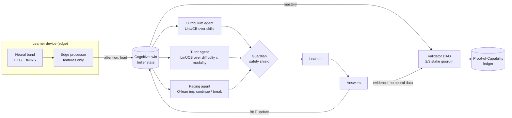

# Cognitive Twin

**A multi-agent reinforcement learning system for personalised education.**

Three cooperating RL agents learn *how to teach* each learner: what to study next, at what difficulty and in which style, and when to pause. They act on a **cognitive twin**, a Bayesian model of what the learner knows, enriched by an optional **ambient neural sensor** whose raw signals never leave the device. When the twin shows mastery, a **validator DAO** reviews the answer evidence and signs a verifiable **Proof-of-Capability** credential onto a hash-chained ledger.

> Personal research project. Not affiliated with, endorsed by or built for any employer.

**Status: v0.2, phase one (pilot-ready).** The service now persists everything in PostgreSQL, signs credentials with KMS-held keys, signs people in through their institution, enforces consent and data rights, and ships with infrastructure as code, CI/CD, monitoring and runbooks. See [what's production-ready and what still needs a real environment](docs/requirements-traceability.md).



<p>
  
  
</p>

### Designed to be easy to use

- **Two clear ways in:** *Learn it myself* (answer questions) or *Watch a demo* (see the tutors teach a simulated student, with play, pause, step and speed).
- **Plain language everywhere.** Every question has a "Why this question?" in everyday words, and progress reads as "the tutors are 72% sure you know this".
- **A learning path you can read at a glance:** locked, ready, learning, mastered and credentialed skills, plus what unlocks each one.
- **Breaks are suggestions,** spaced out and skippable with "Keep going". Nothing nags.
- **Keyboard friendly** (A–D or 1–4 to answer, Enter for next), screen-reader labels and live regions, large tap targets, works on phones, follows light or dark mode, and respects reduced motion.
- **The technical detail is optional:** agent decisions, guardian interventions, validators and raw model state sit under "Under the hood".

## Results in simulation

Policies are trained on a population of simulated learners (sim-to-real: you don't experiment on real students). Benchmarked on 200 held-out simulated learners, 80 steps each, all teachers facing the same learners:

| Teacher | Knowledge gained (of 7 skills) | Skills mastered | Breaks | Accuracy |
|---|---:|---:|---:|---:|
| **Multi-agent RL (trained)** | **3.93** | **3.05** | 13.0 | 0.56 |
| Multi-agent RL (untrained) | 1.93 | 0.00 | 3.8 | 0.71 |
| Fixed syllabus | 3.12 | 0.21 | 5.0 | 0.44 |
| Random | 1.46 | 0.01 | 0.0 | 0.39 |

"Mastered" counts skills whose *true* simulated knowledge reaches 0.8. The trained agents produce **26% more learning than a fixed syllabus and about 15x as many truly mastered skills**: instead of spreading time evenly, they push each skill over the line before moving on. Accuracy is *lower* than the untrained policy's on purpose: the tutor learned that slightly-too-hard items teach more than easy ones (desirable difficulty).

**Credential integrity:** across those learners the DAO issued 718 credentials; 80% went to skills with true knowledge of at least 0.8, and 95% to at least 0.7. Reproduce everything with `cognitive-twin train`; full output is in [`docs/benchmark.json`](docs/benchmark.json).

These are simulation results. The simulator encodes assumptions from learning science (prerequisites, desirable difficulty, fatigue, modality fit) and needs calibrating against real learner data before anyone draws conclusions about real students.

## The agents

| Agent | Decides | Algorithm | Observes | Reward |
|---|---|---|---|---|
| **Curriculum** | Which skill, held for a 4-step option | LinUCB over skills | Belief, prerequisite readiness, recent accuracy | Mean knowledge gain over the option |
| **Tutor** | Difficulty (1 to 3) and modality (worked example, Socratic dialogue, spatial simulation) | LinUCB over 9 arms | Belief, attention, load, fatigue, accuracy | Knowledge gain on the step |
| **Pacing** | Continue or break | Tabular Q-learning (gamma 0.9) | Steps since break, attention | Gain now, plus the discounted value of a fresher learner |
| **Guardian** | What the others may do | Rule-based shield | Twin, consent | — (logs every override) |

The agents share one team objective (knowledge gain) in a hierarchy: curriculum sets the goal, tutor executes it, pacing protects it. In simulation they train on the true knowledge gain; with real learners the only signal is the twin's change in belief (`reward="belief"`). See [`docs/rl-design.md`](docs/rl-design.md).

## Quick start

```bash
docker compose up --build          # PostgreSQL + Redis + the app, at http://localhost:8000
```

Or without Docker (SQLite, development mode):

```bash
pip install -e ".[dev]"
cognitive-twin serve               # http://127.0.0.1:8000
pytest                             # 88 tests; set TEST_DATABASE_URL to run them on PostgreSQL
cognitive-twin train               # retrain in simulation and print the benchmark
```

Development servers offer **development sign-in**: one click to act as a learner, an educator, an administrator, an EU learner or an under-18 learner, so you can see every role and rule. Staging and production refuse it and use the institution's single sign-on.

## API

| Who | Routes |
|---|---|
| Anyone | `GET /api/public/credentials/{id}/verify`, `GET /api/public/keys`, `GET /healthz`, `GET /readyz` |
| Sign-in | `GET /auth/login` → institution SSO → `/auth/callback`; `POST /auth/logout`; `GET /auth/session` |
| Learner (own data only) | `GET /api/me`, `POST /api/me/consent`, `POST /api/me/next`, `POST /api/me/answer`, `POST /api/me/break`, `POST /api/me/credentials`, `GET /api/me/export`, `POST /api/me/delete` |
| Educator (own cohorts) | `GET /api/educator/cohorts`, `…/cohorts/{id}/learners`, `…/learners/{id}`, `POST …/learners/{id}/credentials`, `POST …/credentials/{id}/revoke` |
| Administrator | `/api/admin/policies` (upload, activate = roll back), `/api/admin/keys` (rotate), `/api/admin/validators`, `/api/admin/ledger/verify`, `/api/admin/audit` |

Browser sessions use an HttpOnly cookie plus a CSRF token; API clients can use institution-issued bearer tokens. Interactive docs are at `/docs` on development servers.

## Privacy and safety by design

- **Raw neural data never leaves the edge processor**; only three features do (attention, load, signal quality).
- **Neural sensing is opt-in**, off under 16, needs guardian consent for minors, and is **disabled in the EU** (the EU AI Act bans emotion recognition in education settings).
- **Neural features shape teaching, never grading.** Credential evidence is built from answers only, and the code asserts this.
- **Shielded RL**: agents explore only inside the Guardian's safe action set, and every override is logged for educators.
- **Live sessions don't update the shared policy.** Policies are retrained offline and redeployed, so behaviour stays reviewable.

More in [`docs/privacy.md`](docs/privacy.md).

## Repository layout

```
src/cognitive_twin/
  app.py, deps.py           application factory, auth dependencies, commit-in-thread routes
  api/                      auth, learner, educator/admin, public routes
  auth/                     OIDC client, signed sessions, user provisioning
  db/                       models, Alembic migrations, append-only triggers, ct_app role
  learning.py               teaching loop on the database (stateless)
  ledger/service.py         DB-backed ledger: issuance, revocation, verification
  keys.py                   KMS and local key providers, key registry and rotation
  policy_store.py           versioned teaching policies and rollback
  security.py, observability.py   headers, rate limits, JSON logs, metrics, tracing
  rl/, env/, twin.py, edge/ the multi-agent RL core and simulator
  web/                      the web app (strict CSP: no inline scripts)
deploy/terraform/           AWS: VPC, ALB+WAF, ECS Fargate, RDS, Redis, KMS, backups, alarms
deploy/observability/       Prometheus alert rules (+ unit tests), Grafana dashboard
loadtest/                   Locust load test with an SLO gate
docs/                       production guide, runbooks, compliance, traceability, RL design
```

## Honest limits

- **Not yet deployed.** The infrastructure is written and validated in CI, but staging still needs a first `terraform apply`, a 2,000-learner load test, a restore test and an external penetration test.
- **Phase-one validators are not independent:** all four validator keys are operated by this service. Phase two gives each organisation its own keys and infrastructure.
- Evidence uses salted hash commitments, not zero-knowledge proofs.
- The neural headband is disabled; the simulator is uncalibrated against real learners; there is one content track of 42 items.
- Teaching results come from simulation, not from students.

## License

MIT. See [LICENSE](LICENSE).
