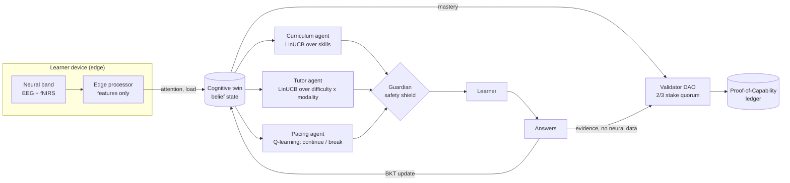
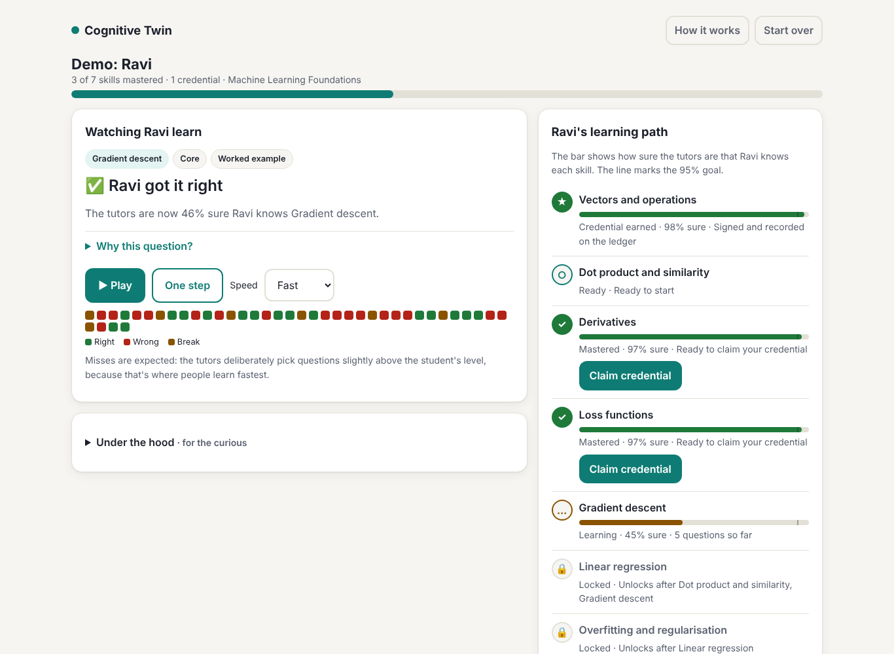
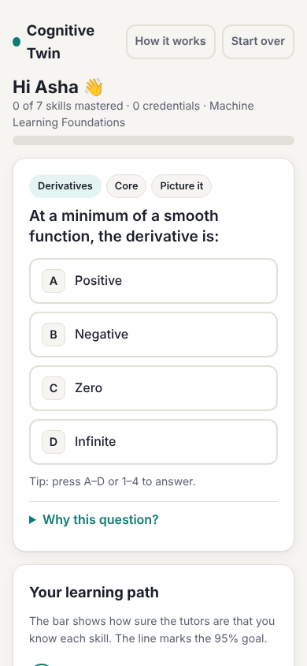

# Cognitive Twin

**A multi-agent reinforcement learning system for personalised education.**

Three cooperating RL agents learn *how to teach* each learner: what to study next, at what difficulty and in which style, and when to pause. They act on a **cognitive twin**, a Bayesian model of what the learner knows, enriched by an optional **ambient neural sensor** whose raw signals never leave the device. When the twin shows mastery, a **validator DAO** reviews the answer evidence and signs a verifiable **Proof-of-Capability** credential onto a hash-chained ledger.

> Personal research project. Not affiliated with, endorsed by or built for any employer.



<p>
  
  
</p>

### Designed to be easy to use

- **Two clear ways in:** *Learn it myself* (answer questions) or *Watch a demo* (see the tutors teach a simulated student, with play, pause, step and speed).
- **Plain language everywhere.** Every question has a "Why this question?" in everyday words, and progress reads as "the tutors are 72% sure you know this".
- **A learning path you can read at a glance:** locked, ready, learning, mastered and credentialed skills, plus what unlocks each one.
- **Breaks are suggestions,** spaced out and skippable with "Keep going". Nothing nags.
- **Keyboard friendly** (A–D or 1–4 to answer, Enter for next), screen-reader labels and live regions, large tap targets, works on phones, follows light or dark mode, and respects reduced motion.
- **The technical detail is optional:** agent decisions, guardian interventions, validators and raw model state sit under "Under the hood".

## Results in simulation

Policies are trained on a population of simulated learners (sim-to-real: you don't experiment on real students). Benchmarked on 200 held-out simulated learners, 80 steps each, all teachers facing the same learners:

| Teacher | Knowledge gained (of 7 skills) | Skills mastered | Breaks | Accuracy |
|---|---:|---:|---:|---:|
| **Multi-agent RL (trained)** | **3.93** | **3.05** | 13.0 | 0.56 |
| Multi-agent RL (untrained) | 1.93 | 0.00 | 3.8 | 0.71 |
| Fixed syllabus | 3.12 | 0.21 | 5.0 | 0.44 |
| Random | 1.46 | 0.01 | 0.0 | 0.39 |

"Mastered" counts skills whose *true* simulated knowledge reaches 0.8. The trained agents produce **26% more learning than a fixed syllabus and about 15x as many truly mastered skills**: instead of spreading time evenly, they push each skill over the line before moving on. Accuracy is *lower* than the untrained policy's on purpose: the tutor learned that slightly-too-hard items teach more than easy ones (desirable difficulty).

**Credential integrity:** across those learners the DAO issued 718 credentials; 80% went to skills with true knowledge of at least 0.8, and 95% to at least 0.7. Reproduce everything with `cognitive-twin train`; full output is in [`docs/benchmark.json`](docs/benchmark.json).

These are simulation results. The simulator encodes assumptions from learning science (prerequisites, desirable difficulty, fatigue, modality fit) and needs calibrating against real learner data before anyone draws conclusions about real students.

## The agents

| Agent | Decides | Algorithm | Observes | Reward |
|---|---|---|---|---|
| **Curriculum** | Which skill, held for a 4-step option | LinUCB over skills | Belief, prerequisite readiness, recent accuracy | Mean knowledge gain over the option |
| **Tutor** | Difficulty (1 to 3) and modality (worked example, Socratic dialogue, spatial simulation) | LinUCB over 9 arms | Belief, attention, load, fatigue, accuracy | Knowledge gain on the step |
| **Pacing** | Continue or break | Tabular Q-learning (gamma 0.9) | Steps since break, attention | Gain now, plus the discounted value of a fresher learner |
| **Guardian** | What the others may do | Rule-based shield | Twin, consent | — (logs every override) |

The agents share one team objective (knowledge gain) in a hierarchy: curriculum sets the goal, tutor executes it, pacing protects it. In simulation they train on the true knowledge gain; with real learners the only signal is the twin's change in belief (`reward="belief"`). See [`docs/rl-design.md`](docs/rl-design.md).

## Quick start

```bash
pip install -e ".[dev]"
cognitive-twin demo            # one simulated learner, end to end, in the terminal
cognitive-twin serve           # dashboard at http://127.0.0.1:8000
cognitive-twin train           # retrain in simulation and print the benchmark
pytest                         # 25 tests
```

Or with Docker: `docker build -t cognitive-twin . && docker run -p 8000:8000 cognitive-twin`.

In the dashboard, enrol a learner as **simulated** (watch the agents teach) or **"I'll answer myself"** (you are the learner). Toggle region, age and neural opt-in to see the consent policy switch sensing off.

## API

| Method | Path | Purpose |
|---|---|---|
| `POST` | `/api/learners` | Enrol (name, age, region, neural opt-in, guardian consent, simulated) |
| `GET` | `/api/learners/{id}` | Twin, agent log, guardian interventions, credentials |
| `POST` | `/api/learners/{id}/next` | Agents decide the next step (item without its answer key, or a break) |
| `POST` | `/api/learners/{id}/answer` | Submit a human answer |
| `POST` | `/api/learners/{id}/break` | Finish a break |
| `POST` | `/api/learners/{id}/autoplay` | Let a simulated learner run N steps |
| `POST` | `/api/learners/{id}/credentials` | Ask the validator DAO for a credential |
| `GET` | `/api/credentials/{id}/verify` | Check signatures, quorum, ledger anchor and chain |
| `GET` | `/api/ledger` · `/api/policy` | Validators, blocks, learned policy statistics |

Interactive docs are at `/docs`.

## Privacy and safety by design

- **Raw neural data never leaves the edge processor**; only three features do (attention, load, signal quality).
- **Neural sensing is opt-in**, off under 16, needs guardian consent for minors, and is **disabled in the EU** (the EU AI Act bans emotion recognition in education settings).
- **Neural features shape teaching, never grading.** Credential evidence is built from answers only, and the code asserts this.
- **Shielded RL**: agents explore only inside the Guardian's safe action set, and every override is logged for educators.
- **Live sessions don't update the shared policy.** Policies are retrained offline and redeployed, so behaviour stays reviewable.

More in [`docs/privacy.md`](docs/privacy.md).

## Repository layout

```
src/cognitive_twin/
  env/simulator.py     simulated student population (the RL environment)
  twin.py              Bayesian knowledge tracing belief state
  edge/sensor.py       neural band + on-device feature extraction
  consent.py           consent and regional policy
  rl/agents.py         curriculum, tutor and pacing agents
  rl/bandit.py         LinUCB
  rl/shield.py         Guardian safety shield
  rl/teacher.py        coordinator, baselines, episode runner
  rl/train.py          training and benchmarking
  ledger/ledger.py     validator DAO, verifiable credentials, hash chain
  service.py, api.py   session layer and FastAPI service
  web/index.html       dashboard
  content/             skills graph, question bank, trained policy
docs/                  architecture, RL design, privacy, roadmap
```

## Honest limits of this MVP

- The neural band is simulated; hardware integration is on the roadmap.
- The ledger is a single-process hash chain, and evidence uses salted hash commitments rather than zero-knowledge proofs.
- One content track (Machine Learning Foundations, 7 skills, 42 items).
- Results come from a simulator, not from students. See [`docs/roadmap.md`](docs/roadmap.md) for the path to a randomised pilot.

## License

MIT. See [LICENSE](LICENSE).
