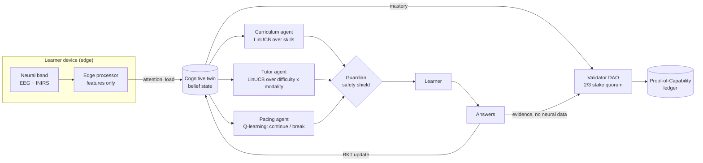

# Cognitive Twin

**A multi-agent reinforcement learning system for personalised education.**

Three cooperating RL agents learn *how to teach* each learner: what to study next, at what difficulty and in which style, and when to pause. They act on a **cognitive twin**, a Bayesian model of what the learner knows, enriched by an optional **ambient neural sensor** whose raw signals never leave the device. When the twin shows mastery, a **validator DAO** reviews the answer evidence and signs a verifiable **Proof-of-Capability** credential onto a hash-chained ledger.

> Personal research project. Not affiliated with, endorsed by or built for any employer.

**Status: v0.3, ready for schools to pilot.** Five subjects for learners from primary school to adulthood, class codes for schools without single sign-on, age-appropriate safeguards for children (including under-13s, with the school confirming a parent's or guardian's agreement), and the phase-one production foundations: PostgreSQL, KMS-signed credentials, consent and data rights, infrastructure as code, CI/CD, monitoring and runbooks. It is code-complete but **not yet deployed**; see [what still needs a real environment and a legal review](docs/requirements-traceability.md).



<p>
  
  
</p>

## For schools

| | |
|---|---|
| **Subjects** | Middle-school maths (ages 11 to 14), high-school algebra (14 to 16), general science (11 to 14), Python programming basics (12+), machine-learning foundations (16+). Each has its own trained tutor team. |
| **Signing in** | Schools with an identity provider use single sign-on. Everyone else uses **class codes**: a teacher creates a class, students join with the code, their first name and a password, and the teacher approves them. No e-mail address is needed. |
| **Ages** | All ages, including under 13. Age groups come from the school's records (the teacher or the school's identity provider), never from the child. Under-18s start only once the school confirms a parent or guardian has agreed. Each school can set a stricter minimum age. |
| **Children** | First name only and no e-mail for under-13s, child-friendly wording, shorter stretches between breaks (12 questions under 13, 18 for teens, 25 for adults), the headband option never shown, and deletion handled by the teacher or parent. |
| **Roles** | Platform administrator (adds schools) → school administrator (invites teachers, chooses subjects and minimum age) → teacher (classes, approvals, password resets, data requests) → learner. Each sees only their own school, classes or data. |

**Setting up a school** takes a few minutes: a platform administrator runs `cognitive-twin school create "Hill Primary" --youngest under13` (or uses the *Schools* tab) and sends the printed invitation code to the school's administrator, who invites teachers from *My school*. Teachers create a class and write its code on the board.

> **Review the questions before real use.** The four new subjects were written for this release (36 questions each) and have not yet been reviewed by subject teachers. Have a teacher check them against your curriculum first.

### Designed to be easy to use

- **Simple sign-in for every age:** three clearly labelled choices (*I have a username*, *I'm joining a class*, *I'm a teacher with a code*), forgiving class codes (case and dashes don't matter), a "Show" button on passwords, and a username card to write down after joining.
- **Teachers stay in charge:** a big class code to put on the board, a waiting list with one-tap approval, students added by hand with a printable one-time password, and password resets that sign the student out everywhere.
- **Pick a subject, keep your progress:** learners choose from the subjects their school offers (their class's subject first) and can switch at any time.
- **Watch a demo** of the tutors teaching a simulated student in any subject, with play, pause, step and speed.
- **Plain language everywhere.** Every question has a "Why this question?" in everyday words, and progress reads as "the tutors are 72% sure you know this".
- **A learning path you can read at a glance:** locked, ready, learning, mastered and credentialed skills, plus what unlocks each one.
- **Breaks are suggestions,** spaced out and skippable with "Keep going". Nothing nags.
- **Keyboard friendly** (A–D or 1–4 to answer, Enter for next), screen-reader labels and live regions, large tap targets, works on phones, follows light or dark mode, and respects reduced motion.
- **The technical detail is optional:** agent decisions, guardian interventions, validators and raw model state sit under "Under the hood".

## Results in simulation

Policies are trained on a population of simulated learners (sim-to-real: you don't experiment on real students). Benchmarked on 200 held-out simulated learners, 80 steps each, all teachers facing the same learners. Machine-learning foundations:

| Teacher | Knowledge gained (of 7 skills) | Skills mastered | Breaks | Accuracy |
|---|---:|---:|---:|---:|
| **Multi-agent RL (trained)** | **3.93** | **3.05** | 13.0 | 0.56 |
| Multi-agent RL (untrained) | 1.93 | 0.00 | 3.8 | 0.71 |
| Fixed syllabus | 3.12 | 0.21 | 5.0 | 0.44 |
| Random | 1.46 | 0.01 | 0.0 | 0.39 |

"Mastered" counts skills whose *true* simulated knowledge reaches 0.8. The trained agents produce **26% more learning than a fixed syllabus and about 15x as many truly mastered skills**: instead of spreading time evenly, they push each skill over the line before moving on. Accuracy is *lower* than the untrained policy's on purpose: the tutor learned that slightly-too-hard items teach more than easy ones (desirable difficulty).

**Credential integrity:** across those learners the DAO issued 718 credentials; 80% went to skills with true knowledge of at least 0.8, and 95% to at least 0.7.

The same comparison for the new subjects (6 skills each; knowledge gained and skills mastered):

| Subject | Trained RL | Fixed syllabus | Credentials with true knowledge ≥ 0.8 / ≥ 0.7 |
|---|---|---|---|
| Middle-school maths | 4.23 / 2.31 | 3.10 / 0.36 | 69% / 91% |
| High-school algebra | 4.06 / 2.05 | 2.72 / 0.27 | 72% / 87% |
| General science | 4.26 / 2.62 | 3.09 / 0.27 | 65% / 88% |
| Python basics | 3.98 / 2.54 | 2.62 / 0.26 | 76% / 90% |

The tutors beat a fixed syllabus in every subject, but credential precision is lower than for the original track (smaller question banks, a more permissive simulated population); tightening the issuance threshold per subject is on the roadmap. Reproduce with `cognitive-twin train --track <subject>`; full output is in [`docs/benchmarks/`](docs/benchmarks/).

These are simulation results. The simulator encodes assumptions from learning science (prerequisites, desirable difficulty, fatigue, modality fit) and needs calibrating against real learner data before anyone draws conclusions about real students.

## The agents

| Agent | Decides | Algorithm | Observes | Reward |
|---|---|---|---|---|
| **Curriculum** | Which skill, held for a 4-step option | LinUCB over skills | Belief, prerequisite readiness, recent accuracy | Mean knowledge gain over the option |
| **Tutor** | Difficulty (1 to 3) and modality (worked example, Socratic dialogue, spatial simulation) | LinUCB over 9 arms | Belief, attention, load, fatigue, accuracy | Knowledge gain on the step |
| **Pacing** | Continue or break | Tabular Q-learning (gamma 0.9) | Steps since break, attention | Gain now, plus the discounted value of a fresher learner |
| **Guardian** | What the others may do | Rule-based shield | Twin, consent | — (logs every override) |

The agents share one team objective (knowledge gain) in a hierarchy: curriculum sets the goal, tutor executes it, pacing protects it. In simulation they train on the true knowledge gain; with real learners the only signal is the twin's change in belief (`reward="belief"`). See [`docs/rl-design.md`](docs/rl-design.md).

## Quick start

```bash
docker compose up --build          # PostgreSQL + Redis + the app, at http://localhost:8000
```

Or without Docker (SQLite, development mode):

```bash
pip install -e ".[dev]"
cognitive-twin serve               # http://127.0.0.1:8000
pytest                             # 98 tests; set TEST_DATABASE_URL to run them on PostgreSQL
cognitive-twin train               # retrain in simulation and print the benchmark
```

Development servers start with a *Demo School* whose classes have the codes **MATHS5A**, **ALGEBRA9B** and **MLPILOTA**, and offer **development sign-in**: one click to act as an adult learner, a 15-year-old, a 10-year-old, a teenager still waiting for guardian consent, a teacher, a school administrator or the platform administrator. Staging and production refuse development sign-in.

## API

| Who | Routes |
|---|---|
| Anyone | `GET /api/public/credentials/{id}/verify`, `GET /api/public/keys`, `GET /healthz`, `GET /readyz` |
| Sign-in | `GET /auth/login` → school SSO → `/auth/callback`; `POST /auth/local-login`, `POST /auth/join` (class code), `POST /auth/invite` (staff), `POST /auth/password`, `POST /auth/logout`, `GET /auth/session` |
| Learner (own data only; add `?track=<subject>`) | `GET /api/me/subjects`, `GET /api/me`, `POST /api/me/consent`, `POST /api/me/next`, `POST /api/me/answer`, `POST /api/me/break`, `POST /api/me/credentials`, `GET /api/me/export`, `POST /api/me/delete` (adults) |
| Teacher (own classes) | `GET/POST /api/educator/cohorts`, `POST …/cohorts/{id}/code`, `…/cohorts/{id}/learners`, `POST …/cohorts/{id}/students`, `POST …/learners/{id}/approve`, `POST …/learners/{id}/password`, `GET …/learners/{id}/export`, `POST …/learners/{id}/delete`, `POST …/learners/{id}/credentials`, `POST …/credentials/{id}/revoke` |
| School administrator (own school) | `GET /api/school`, `POST /api/school/settings`, `POST /api/school/invites`, `POST /api/school/staff/{id}/password`, plus every teacher route for the whole school |
| Platform administrator | `/api/admin/schools` (create, invite), `/api/admin/policies` (per subject; activate = roll back), `/api/admin/keys` (rotate), `/api/admin/validators`, `/api/admin/ledger/verify`, `/api/admin/audit` |

Browser sessions use an HttpOnly cookie plus a CSRF token; API clients can use institution-issued bearer tokens. Interactive docs are at `/docs` on development servers.

## Privacy and safety by design

- **Raw neural data never leaves the edge processor**; only three features do (attention, load, signal quality).
- **Neural sensing is opt-in**, off under 16, needs guardian consent for minors, and is **disabled in the EU** (the EU AI Act bans emotion recognition in education settings).
- **Neural features shape teaching, never grading.** Credential evidence is built from answers only, and the code asserts this.
- **Shielded RL**: agents explore only inside the Guardian's safe action set, and every override is logged for educators.
- **Live sessions don't update the shared policy.** Policies are retrained offline and redeployed, so behaviour stays reviewable.
- **Children's data is minimised and school-controlled:** age and guardian consent come from school records and are logged append-only; under-13s keep only a first name; schools can export or delete a learner's data on a parent's request. Schools may only consent for school-directed educational use; nothing is used commercially or for advertising.
- **Passwords** are hashed with scrypt; five wrong tries pause an account for 15 minutes; resets sign the person out everywhere; sign-in endpoints are rate limited per IP.

More in [`docs/privacy.md`](docs/privacy.md).

## Repository layout

```
src/cognitive_twin/
  app.py, deps.py           application factory, auth dependencies, commit-in-thread routes
  api/                      auth, learner, teacher/school/admin, public routes
  schools.py                schools, classes and codes, invitations, local accounts, guardian consent
  content/tracks, policies/ the five subjects and their trained teaching policies
  auth/                     OIDC client, signed sessions, user provisioning
  db/                       models, Alembic migrations, append-only triggers, ct_app role
  learning.py               teaching loop on the database (stateless)
  ledger/service.py         DB-backed ledger: issuance, revocation, verification
  keys.py                   KMS and local key providers, key registry and rotation
  policy_store.py           versioned teaching policies and rollback
  security.py, observability.py   headers, rate limits, JSON logs, metrics, tracing
  rl/, env/, twin.py, edge/ the multi-agent RL core and simulator
  web/                      the web app (strict CSP: no inline scripts)
deploy/terraform/           AWS: VPC, ALB+WAF, ECS Fargate, RDS, Redis, KMS, backups, alarms
deploy/observability/       Prometheus alert rules (+ unit tests), Grafana dashboard
loadtest/                   Locust load test with an SLO gate
docs/                       production guide, runbooks, compliance, traceability, RL design
```

## Honest limits

- **Not yet deployed.** The infrastructure is written and validated in CI, but staging still needs a first `terraform apply`, a 2,000-learner load test, a restore test and an external penetration test.
- **Phase-one validators are not independent:** all four validator keys are operated by this service. Phase two gives each organisation its own keys and infrastructure.
- Evidence uses salted hash commitments, not zero-knowledge proofs.
- **Children's privacy law differs by country.** The design follows the common pattern (school-directed use, school-confirmed guardian consent, minimal data), but a lawyer must confirm it for each country before under-18s, and especially under-13s, use it. See [`docs/compliance/children.md`](docs/compliance/children.md).
- The four new subjects have not been reviewed by subject teachers yet, and each has 36 questions, so questions repeat for learners who practise a lot.
- The neural headband is disabled; the simulator is uncalibrated against real learners.
- Teaching results come from simulation, not from students.

## License

MIT. See [LICENSE](LICENSE).
