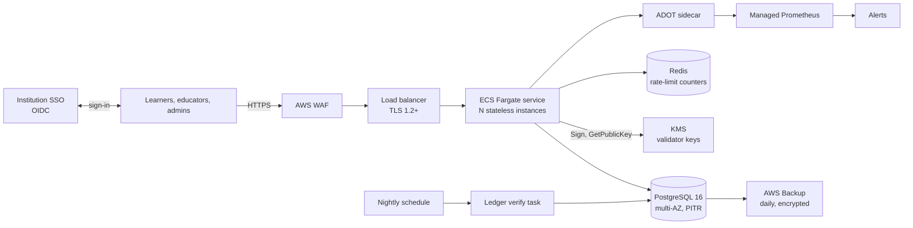

# Running Cognitive Twin in production

This covers what phase one adds on top of the research prototype: how the service is deployed, configured and operated. Requirement numbers (R1.1 and so on) refer to the [phase-one requirements](https://claude.ai/artifact/TEDW76LuV3tQVnmSDmJFAV); [requirements-traceability.md](requirements-traceability.md) maps each one to code and tests.

## Architecture

- **Stateless service (R1.4).** Each request loads the learner's state from PostgreSQL under a row lock and writes it back in the same transaction. Rate-limit counters live in Redis. Any instance can serve any request.
- **Append-only records (R1.2, R4.2).** Ledger blocks, credentials, revocations, consent records, policy activations and the audit log reject UPDATE, DELETE and TRUNCATE, enforced by triggers *and* by the `ct_app` role's grants.
- **Keys (R2).** Validator keys are KMS keys the service can only sign with. Credentials record the key ID and version; verification uses stored public keys, so it survives restarts, rotation and KMS outages.
- **Identity (R3).** Schools with an identity provider sign in through it (role, age group, guardian consent, region and classes come from its claims). Schools without one use class codes and usernames (`CT_LOCAL_ACCOUNTS`, on by default): no e-mail, scrypt-hashed passwords, lockout after 5 tries, invitation codes for staff. See [children's data](compliance/children.md).

## Environments (R5.4)

| | Staging | Production |
|---|---|---|
| Terraform vars | `deploy/terraform/envs/staging.tfvars` | `envs/production.tfvars` |
| Database | single-AZ, 14-day PITR | multi-AZ + read replica, 35-day PITR |
| Instances | 2 to 4 | 3 to 10 (CPU autoscaling) |
| Demo mode | on | off |

Every change goes to staging first: `.github/workflows/deploy.yml` builds one image, releases it to staging (infrastructure, migrations, rollout, smoke test), and only then to production, which needs a reviewer's approval on the `production` GitHub environment.

## First-time setup

1. **Terraform state:** create an S3 bucket and a DynamoDB lock table; put their names in `envs/*.backend.hcl`.
2. **Certificate:** issue an ACM certificate for the domain; set `certificate_arn` and `domain`.
3. **Institution IdP:** register an OIDC client with redirect URI `https://<domain>/auth/callback`, scopes `openid email profile`, and these claims in the ID token (names are configurable via `CT_CLAIM_*`):

   | Claim | Meaning | Required |
   |---|---|---|
   | `ct_role` | `learner`, `educator`, `school_admin` or `admin` | yes |
   | `ct_age_band` (`under13`, `13to17`, `adult`), or `ct_adult_verified` (boolean), or `birthdate` | age group from school records; the birthdate is not stored | for learners |
   | `ct_guardian_consent` (boolean) | the school holds a parent's or guardian's agreement | for under-18s |
   | `ct_region` | e.g. `IN`, `UK`, `EU` | yes |
   | `ct_cohorts` | list of class names | for learners and teachers |
   | `ct_institution` | the school; users with the same value share a school | recommended |

   Schools that don't have an identity provider skip this step and use class codes (step 9).

4. **GitHub:** create `staging` and `production` environments (production with required reviewers), the secret `AWS_DEPLOY_ROLE_ARN` (an IAM role trusting GitHub OIDC) and the variable `AWS_REGION`.
5. **Deploy staging** (run the Deploy workflow), then set the IdP client secret:
   `aws secretsmanager put-secret-value --secret-id ct-staging/oidc-client-secret --secret-string '<secret>'`
6. **Register validators and keys** as one-off tasks: for each validator, `cognitive-twin validators add <id> "<name>" <stake>` then `cognitive-twin keys rotate <id> --kms-key-arn <arn>` (ARNs are in the `validator_kms_keys` Terraform output).
7. **Teaching policies** for all five subjects are activated automatically on first start from `src/cognitive_twin/content/policies/` (logged as `policy.bundled_import`). Later versions go through `cognitive-twin policy import FILE` and roll back with `policy activate`.
8. **Run the restore test** ([runbook](runbooks/backup-restore.md)), the **load test** ([load-testing.md](load-testing.md)) and the **penetration test** ([scope](compliance/pentest-scope.md)) on staging.

9. **Add schools:** `cognitive-twin school create "Hill Primary" --region IN --youngest under13` prints a one-time invitation code for the school's administrator (or use the *Schools* tab as a platform administrator). The school administrator signs in with *I'm a teacher with a code*, invites teachers and chooses subjects and minimum age; teachers create classes and share their class codes. Before under-18s use it, work through the [children's data checklist](compliance/children.md#before-children-use-it-checklist).

**Upgrading from v0.2.** Migration `0002` moves every existing user and cohort into one school named after the partner institution (single sign-on, adults only, as before) and keeps each learner's progress as their *machine-learning foundations* subject. It is not reversible: take a snapshot first. The deploy task already runs `cognitive-twin db create-app-role` after migrating, which grants the `ct_app` role access to the new tables.

## Configuration reference

| Variable | Purpose |
|---|---|
| `CT_ENV` | `development`, `test`, `staging` or `production`. Outside development the service refuses unsafe settings at boot. |
| `DATABASE_URL`, or `DB_HOST`/`DB_PORT`/`DB_NAME`/`DB_USER`/`DB_PASSWORD`/`DB_SSLMODE` | PostgreSQL |
| `CT_DB_POOL_SIZE`, `CT_DB_MAX_OVERFLOW` | Connections per process (default 5 + 5) |
| `REDIS_URL` | Shared rate-limit counters (required outside development) |
| `CT_SESSION_SECRET` | 32+ random characters; rotating it signs everyone out |
| `CT_PUBLIC_BASE_URL`, `CT_ALLOWED_HOSTS`, `CT_TRUSTED_PROXY_HOPS` | Public URL, host allow-list, load-balancer hops for client IPs |
| `OIDC_ISSUER`, `OIDC_CLIENT_ID`, `OIDC_CLIENT_SECRET`, `CT_API_AUDIENCE` | School SSO; bearer tokens for API clients. Optional if class codes are on |
| `CT_LOCAL_ACCOUNTS` | Class codes, usernames and staff invitations (default on). At least one of SSO or this must be enabled |
| `CT_CLAIM_ROLE`, `CT_CLAIM_AGE_BAND`, `CT_CLAIM_ADULT`, `CT_CLAIM_BIRTHDATE`, `CT_CLAIM_GUARDIAN`, `CT_CLAIM_REGION`, `CT_CLAIM_COHORTS`, `CT_CLAIM_INSTITUTION` | Rename the IdP claims above |
| `CT_KEY_PROVIDER` | `aws-kms` (required outside development) or `local` |
| `CT_CONSENT_POLICY_VERSION` | Changing it asks every learner to consent again |
| `CT_RATE_*_PER_MIN` | Per-user, per-IP, sign-in and credential limits |
| `CT_METRICS_TOKEN` | Bearer token required on `/metrics` |
| `CT_DEMO_ENABLED` | Simulated-student demo (off in production) |
| `OTEL_EXPORTER_OTLP_ENDPOINT` | Turns on tracing |

**Connection budget:** instances × workers × (pool + overflow) must stay below the database's `max_connections`. Production at full scale is 10 × 2 × 10 = 200 connections, within the default for `db.r7g.large`. Add RDS Proxy if you scale further.

## Operations

| Task | Command or place |
|---|---|
| Apply migrations | `cognitive-twin migrate` (the deploy pipeline runs it as a one-off task) |
| Roll back a policy | Admin › Teaching policies, or [policy rollback](runbooks/policy-rollback.md) |
| Rotate or revoke keys | [Key management](runbooks/key-management.md) |
| Verify the ledger | Admin › Ledger, or `cognitive-twin ledger verify` (also nightly) |
| Incidents and breaches | [Incident response](runbooks/incident-response.md) |
| Dashboards and alerts | `deploy/observability/grafana-dashboard.json`, `alerts.yml` |
